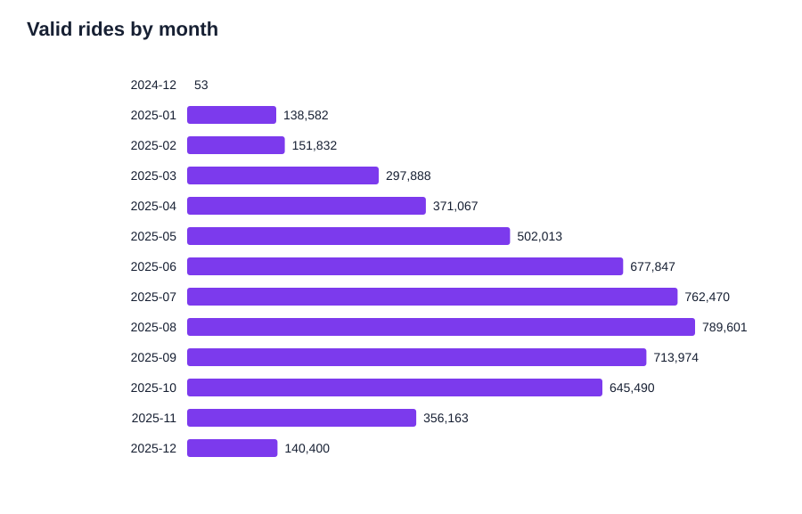

# Divvy Bike Share Analysis

A reproducible case study of 2025 Divvy bike-share trips. The goal is to compare casual riders with annual members and identify evidence that can inform membership-conversion marketing.

## Highlights

- **5,552,994** raw 2025 trip records in a local SQLite warehouse.
- **5,547,380** valid rides after removing 5,614 duration anomalies.
- Automated monthly ingestion workflow and a SQL Server migration workflow.
- Data-quality filtering removes zero/negative-duration and over-24-hour rides.
- Reproducible CSV summaries and SVG charts for segment, monthly, weekday, bike-type, and station analysis.

## Repository layout

```text
data/                 Local-only raw files and SQLite warehouse (not committed)
notebooks/            Original exploratory notebook
scripts/              Reproducible analysis code
sql_queries/          SQL Server equivalents of core analysis queries
outputs/              Generated charts and CSV summaries (not committed by default)
DATA_DICTIONARY.md    Field definitions and quality rules
REPORT.md             Business task, method, and recommended next steps
```

## Quick start

1. Create a local SQLite warehouse at `data/divvy_2025.db` with a `trips` table containing the fields in [DATA_DICTIONARY.md](DATA_DICTIONARY.md).
2. Use Python 3.11 or later.
3. From the repository root, run:

   ```bash
   python scripts/analyze_divvy.py
   ```

4. Review the generated files in `outputs/`.

## Selected findings

| Rider type | Valid rides | Average ride length |
| --- | ---: | ---: |
| Annual member | 3,552,569 | 11.95 minutes |
| Casual rider | 1,994,811 | 19.13 minutes |

Casual riders took fewer trips but rode about 60% longer on average. August had the highest total valid-trip volume. See [REPORT.md](REPORT.md) for interpretation and the generated tables for the full breakdown.




## Data source and privacy

Trip data comes from the public [Divvy trip-data archive](https://divvy-tripdata.s3.amazonaws.com/index.html). Raw source files and the local database are intentionally excluded from Git because of their size. This repository contains code, documentation, and reproducible aggregated outputs only.

## Key limitations

- The data has no demographic or marketing-exposure fields.
- Station and coordinate values can be missing.
- Behavioral patterns are descriptive and do not prove that a campaign would cause conversion.

See [REPORT.md](REPORT.md) for the full methodology and next-step recommendation.
